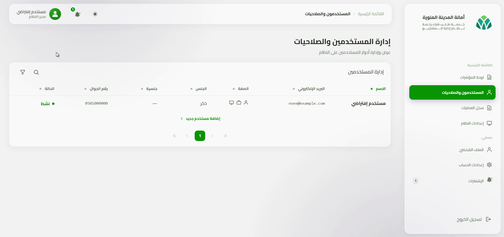
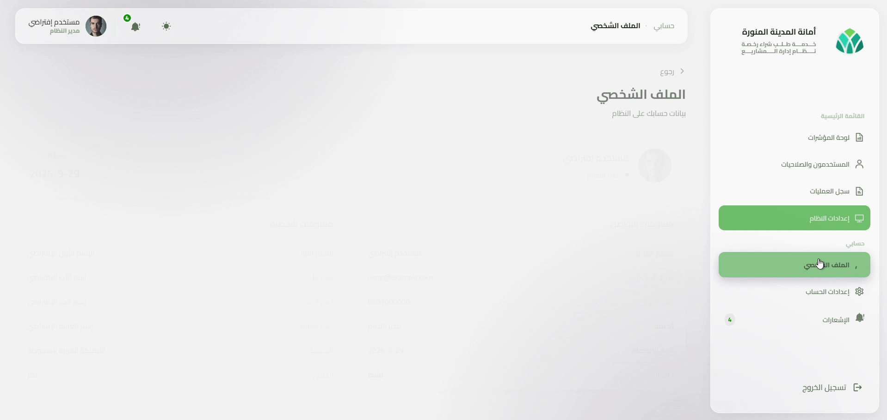
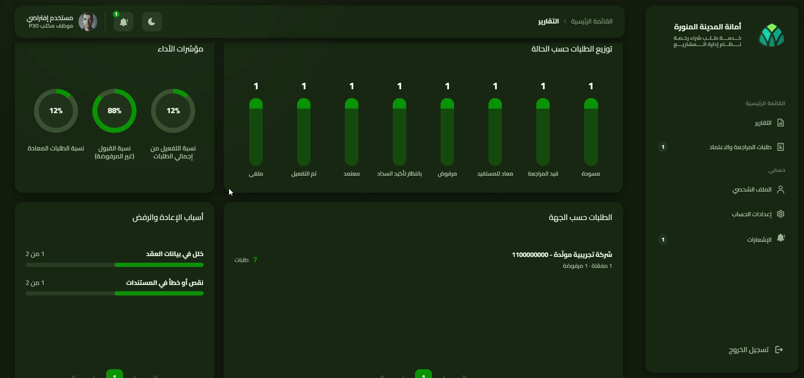
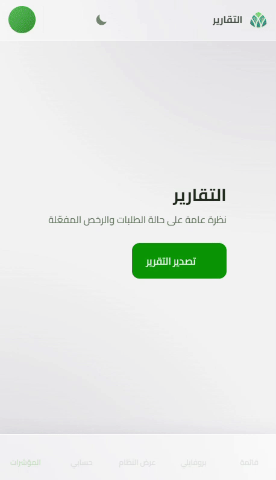
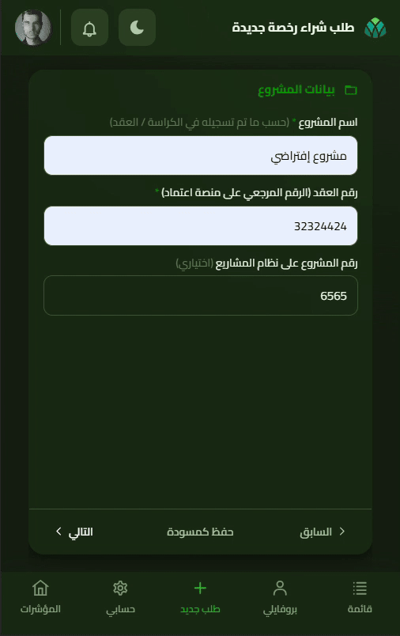
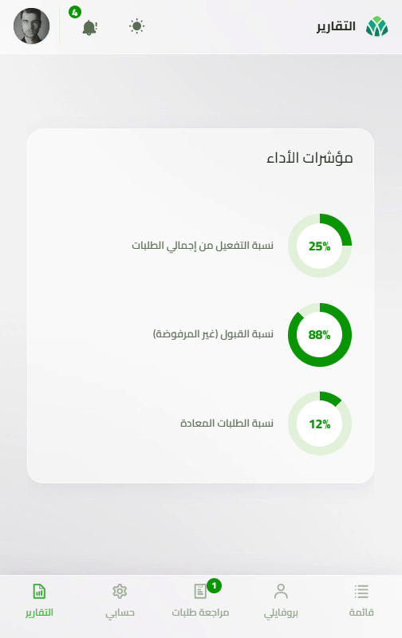
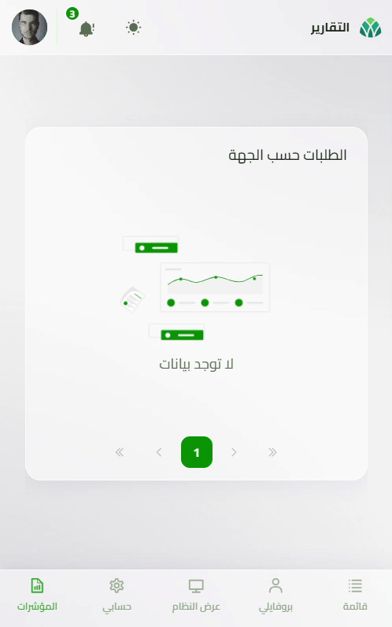
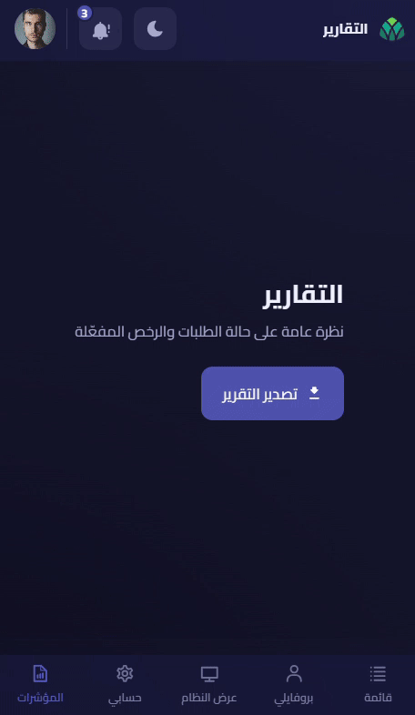
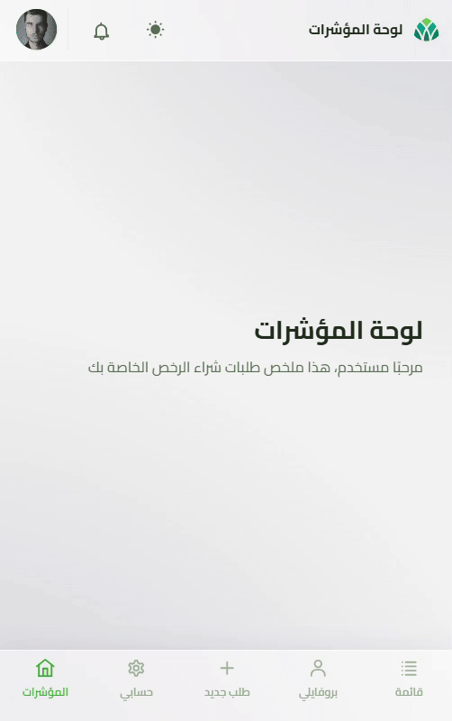
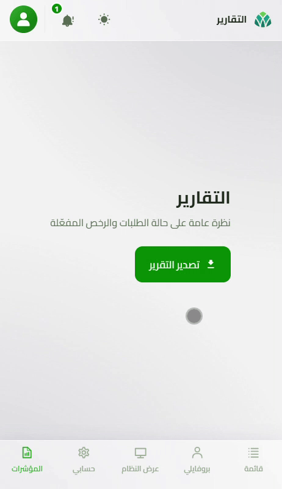

# PMIS — README

## Architecture

Layered ASP.NET Core (net10.0) app:

```
Presentation   Controllers/ + Views/ (thin) + wwwroot/js/site.js (main UI logic)
Application    Interfaces/ + Services/ + DTOs/
Domain         Entities/ + Enums/ + ValueObjects/ (no framework/DB dependencies)
Infrastructure EF Core (SQL Server), MongoDB, Redis, MinIO, external API clients
```

Dependencies point inward (Presentation → Application → Domain ← Infrastructure). Domain has no
external dependencies. Business logic lives in Application services, not controllers.

## Services Used

| Service | Purpose |
|---|---|
| **SQL Server** | Main relational database (users, requests, licenses, settings) via EF Core |
| **MongoDB** | Audit log + notifications |
| **Redis** | OTP codes, login lockout, Nafath session state, Data Protection keys, reference-data cache |
| **MinIO** | File storage (attachments, profile photos) |
| **ClamAV** | Virus scanning for uploaded files |
| **Caddy** | Reverse proxy / TLS termination — **production only**, not used in dev |

All five dev services (SQL Server, MongoDB, Redis, MinIO, ClamAV) are defined in
[docker-compose.yml](../docker-compose.yml). Caddy is defined separately in
`docker-compose.prod.yml` for production deployments.

## How to Run (Development)

From the repo root, in PowerShell:

```powershell
.\Scripts\LaunchDev.ps1
```

You'll be prompted to choose:
1. **Run mode** — host (`dotnet run`) or container (rebuild + run in Docker)
2. **Launch profile** (host mode only) — `https` (localhost only) or `lan-http` (reachable on your LAN)

Or skip the prompts with flags: `-Local`, `-AllInterfaces`, or `-Container`.

What the script does automatically:
- Starts all 5 data-tier containers (`docker compose up -d`)
- Waits for MongoDB, SQL Server, MinIO, and Redis to be healthy
- Applies the MongoDB structure migration (`mongo-init.js`)
- Runs `dotnet ef database update` (applies any pending SQL Server migrations)
- Starts the app (host or container, per your choice)

You need Docker running before launching. No manual setup beyond that — the script handles
containers, migrations, and app startup end to end.

## How to Run (Production / Deployment)

Use `LaunchProd.ps1` instead — always containerized, never interactive, never seeds data:

```powershell
.\Scripts\LaunchProd.ps1
```

Before running it for the first time:
- Create `Scripts\var-env-setting.Production.ps1` (copy the shape of `var-env-setting-Dev.ps1`) and fill in real production credentials — the script refuses to start if any `CHANGE_ME_...` placeholder is left unresolved.

What the script does:
- Starts all 5 data-tier containers plus **Caddy** (reverse proxy/TLS termination — the only service exposed on the host; the app itself publishes no port)
- Waits for MongoDB, SQL Server, MinIO, Redis, and Caddy to be healthy
- Runs `dotnet ef database update` (skip with `-SkipMigrations` if migrations were already applied as a separate release step)
- Rebuilds the app image and (re)starts the `app` and `caddy` containers

Once up, the app is reachable only through Caddy at `https://localhost`.

## Should You Run Seed Data?

On first launch **yes**. The launch script does *not* seed anything, it only creates
the schema. A freshly launched app has an empty `Users` table, and since login is Nafath-only
(no password login, no sign-up form), there is no way to create an account through the UI.
Without a seeded admin user, you cannot log in at all.

### First-time setup: add yourself as admin

Run:

```powershell
.\Scripts\SQLServer\SQL_Seed_Data.ps1
```

Choose:
1. **create seed users**
2. **1a) create ONE new user from a National ID you supply**

Enter your own real National ID (this is what Nafath will match you against when you log in),
then fill in the prompted fields (name, nationality, gender, email, mobile), and pick
**`SystemAdministrator`** as the role. You can now log in via Nafath as an admin.

### Optional: sample/test data

You can also run the broader menu:

```powershell
.\Scripts\SeedData.ps1
```

Which offers:
- **SQL Server** — the same admin-creation flow above, a fixed cast of 3 fake test users (one per role), and/or sample request data for an existing user
- **MongoDB** — sample notifications for a user, or clear notifications/audit-log data

These are optional and only useful for testing with sample data — only the "add yourself as
admin" step above is required to use the app at all.

## Gallery

### Desktop Screen Mode

**Login Page**


**Admin Dashboard**


**Manage Users**



**System Settings**


**Consultant/Contractor Dashboard**


**Create Order**


**P30 Dashboard**


**Order Review**


**Notifications**


**Profile And Account Settings**



**Error Page**



### Handheld Screen Mode

**Account Setting**



**Order Creation**



**Order Review**


**Dashbaords**




**System Settings**



**User Notification/LastActivity**



**Users Management Card**

